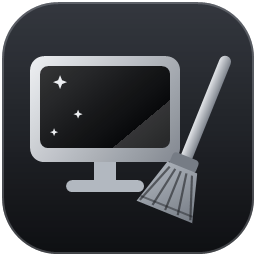
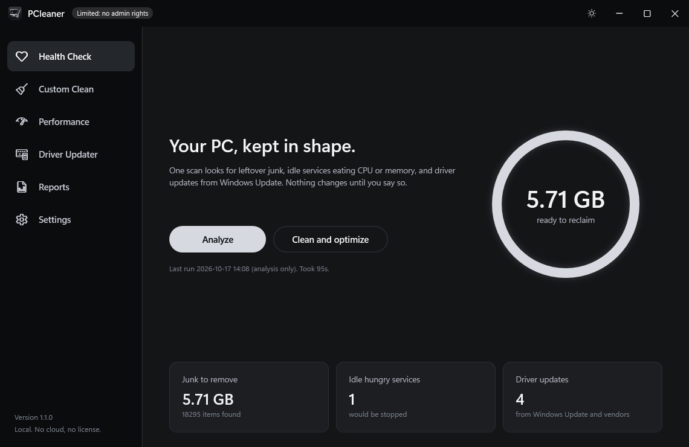
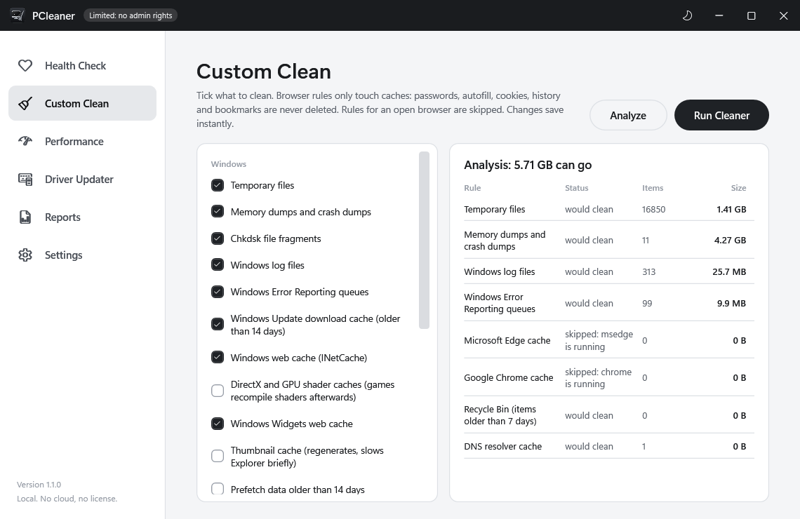
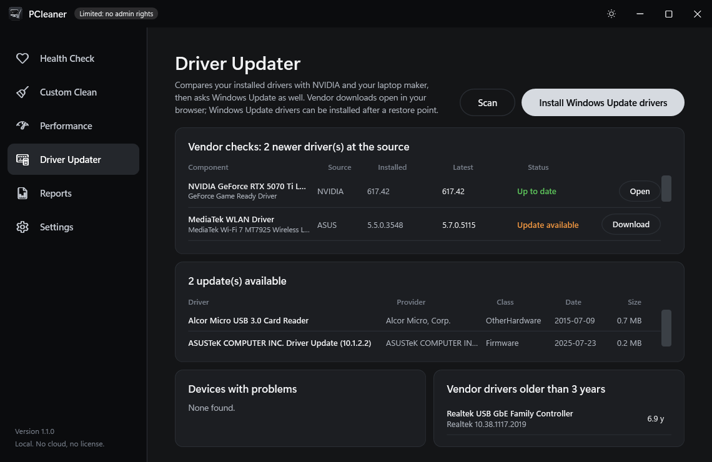
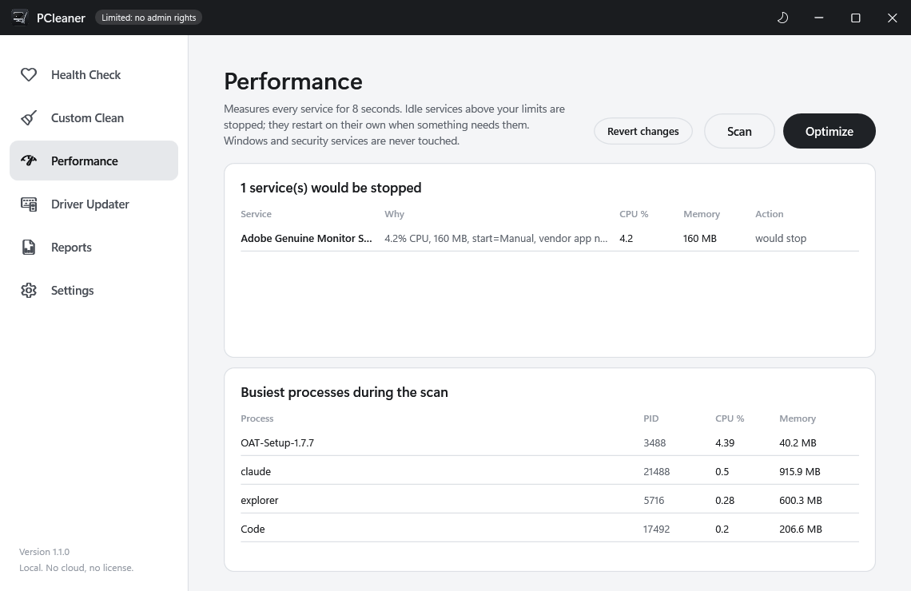

# PCleaner

A small, local, open replacement for the three CCleaner features worth keeping:
junk cleaning, a driver update check, and stopping resource-hungry services that are not in use.
Plain Windows PowerShell 5.1, no dependencies, no cloud, no license, no telemetry.



| | |
|---|---|
|  |  |
|  |  |

## Install

1. Download the latest `PCleaner-x.y.z.zip` from Releases and extract it anywhere.
2. Double-click `Setup.cmd`. Windows asks once whether to run a file from the internet; choose Run.
3. Choose desktop shortcut / weekly schedule / open now, then click **Install**.

PCleaner is installed for your user account in `%LOCALAPPDATA%\Programs\PCleaner`, gets a Start
Menu entry, and appears in Settings > Apps for uninstalling. Nothing is cleaned during install.

Prefer not to install? Double-click `PCleaner.cmd` to open the window straight from the folder.

There are no executables in the download. `Setup.cmd` and `PCleaner.cmd` are two-line batch files
that start the PowerShell scripts in `installer\` and `src\`, so every file in the zip is readable
and the whole package scans clean on VirusTotal ([0/65 for 1.1.0](https://www.virustotal.com/gui/file/21011f960d227a67c9fd34fcf7cd4ad2a63c720158347f7b24b4d8703abc25b9)). A compiled launcher
exists in `build\` and will ship once releases are code-signed; unsigned tiny executables trip
machine-learning antivirus heuristics even when they do nothing wrong.

## Using it

PCleaner opens with one admin prompt into a window laid out like CCleaner: a sidebar of
tools on the left, the tool on the right, and a progress strip with a live log along the
bottom while something runs. Light and dark themes follow Windows or can be fixed in Settings.

| Page | What it does |
|---|---|
| Health Check | **Analyze** scans everything and changes nothing. The ring fills with the space you can reclaim; **Clean and optimize** does it. |
| Custom Clean | Tick the rules you want. Browser rules skip while the browser is open. **Analyze** / **Run Cleaner** for this page only. |
| Performance | Measures services for 8 seconds; **Scan** lists idle hungry ones, **Optimize** stops them, **Revert changes** undoes start-type changes. |
| Driver Updater | **Scan** asks Windows Update; **Install all updates** installs after a restore point. Also lists problem devices and old vendor drivers. |
| Reports | Every past run's HTML report and summary. |
| Settings | Theme, weekly schedule (day and time), notifications, links to the JSON config. |

Every run writes a log, an HTML report and a JSON summary under `%LOCALAPPDATA%\PCleaner\`.
Power users can call `src\Invoke-Maintenance.ps1` directly (`-DryRun`, `-Tasks`, `-InstallDrivers`, `-Revert`).

## What it does, exactly

### Clean (`config\rules.json`)
Rules follow CCleaner's grammar: a folder, file patterns, recurse flag, optional "older than N
days", a `detectFile` guard, and `activeProcesses` that make a rule skip while that app is
running (browser caches are skipped if the browser is open instead of killing it).

Default-on: temp folders (older than 1 day), memory and crash dumps, chkdsk fragments, Windows
logs older than 7 days, Windows Error Reporting queues, Windows Update download cache older than
14 days, INetCache, Widgets cache, Edge / Chrome / Brave / Firefox caches, Recycle Bin items older
than 7 days, DNS cache, Delivery Optimization cache.
Default-off: GPU shader caches (games recompile shaders after a wipe), thumbnail cache, old
prefetch, DISM component cleanup, pip/npm caches. Flip `default` in `rules.json` or add an id to
`clean.disabledRules` in `settings.json`.

Deliberately absent: registry "cleaning", cookies, passwords, history, form data.

### Drivers
Three sources, compared against what is actually installed:
- **NVIDIA**: the GPU is looked up in NVIDIA's own driver service and the installed version
  (read from the driver store, so it works even with the GPU in Eco mode) is compared with the
  latest Game Ready release.
- **Laptop maker**: on ASUS machines the model's official driver list is fetched and matched
  to installed drivers by vendor and device class (Wi-Fi, Bluetooth, audio, chipset, touchpad,
  graphics, control interfaces). Other makers get a direct link to their support page.
  This uses the same undocumented endpoint ASUS's website uses, so it is best-effort.
- **Windows Update**: pending driver updates. These can be installed from PCleaner after a
  restore point; vendor downloads open in your browser so the vendor's installer does the work.

Also listed: devices with a problem status and vendor drivers older than `maxDriverAgeYears`.
What this is not: CCleaner's paid driver catalogue. Devices without a vendor API are shown as
"Not compared" rather than guessed.

### Services
During an 8 second sample, CPU and memory are measured per process and mapped to services.
A running service is stopped only when all of these hold:
- not on `neverTouch` (Defender, networking, audio, update, shell and other core services),
- not a shared `svchost` host, and nothing running depends on it,
- above `cpuPercentThreshold` or `memoryMBThreshold`,
- no visible window belongs to the same vendor folder (the app is not in use),
- start type is Manual (it restarts itself on demand), or the name is in `optionalAutoServices`.

`alwaysStop` forces specific services to stop each run. With `setOptionalAutoToManual` enabled,
opted-in Automatic services are also switched to Manual and recorded in a ledger that
**Revert service changes** undoes.

## Uninstall

Settings > Apps > Installed apps > PCleaner > Uninstall, or run `installer\Uninstall-PCleaner.ps1`.
You are asked whether to keep reports and logs.

## Development

```powershell
.\tests\Run-Tests.ps1            # Pester 3.4 tests (built into Windows)
.\build\Build-Release.ps1        # icon + tests + launcher self-test + dist\PCleaner-<version>.zip
```

Layout: `src\LaptopMaintenance.psm1` holds all logic (rules engine, cleaner, drivers, services,
report); `src\Invoke-Maintenance.ps1` is the CLI entry; `src\PCleaner.ps1` plus `src\ui\*.xaml`
the WPF window (two plain resource dictionaries, black-and-silver dark and silver-and-black light, laid out like CCleaner);
`installer\` the per-user installer; `docs\superpowers\specs\` the design notes, including the
evidence gathered from CCleaner 7 with REA. CCleaner's rule file is copyrighted and was not
copied; the rules here are an independent set.

## License

MIT. See `LICENSE`.
